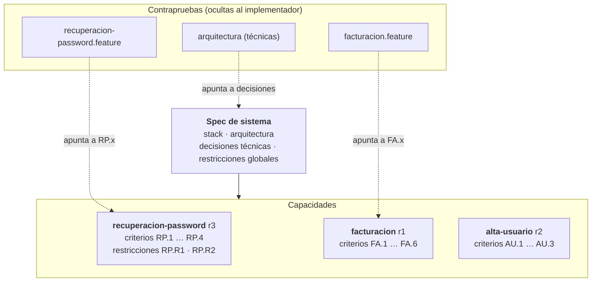
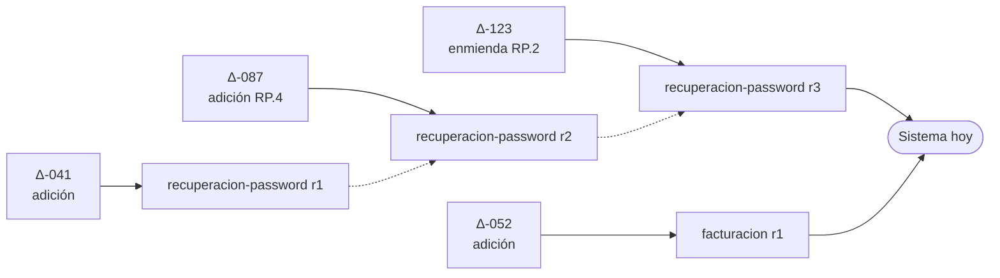
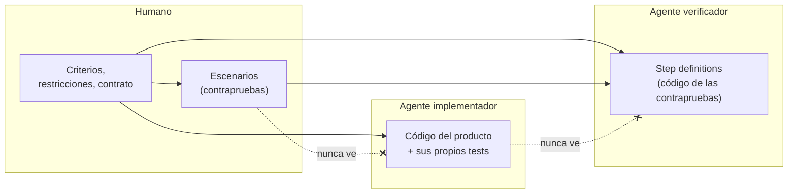
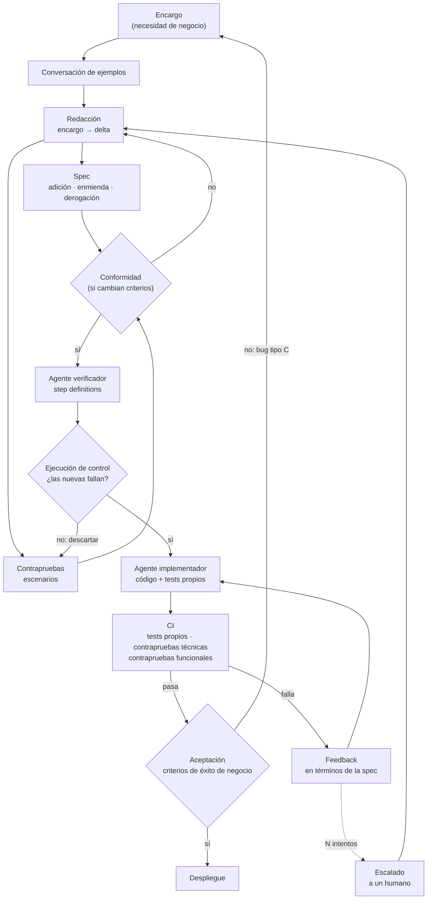
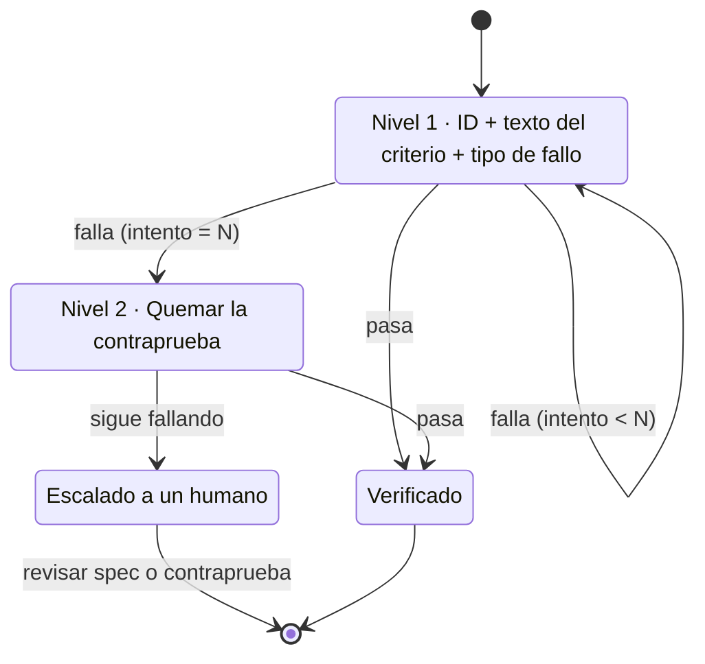
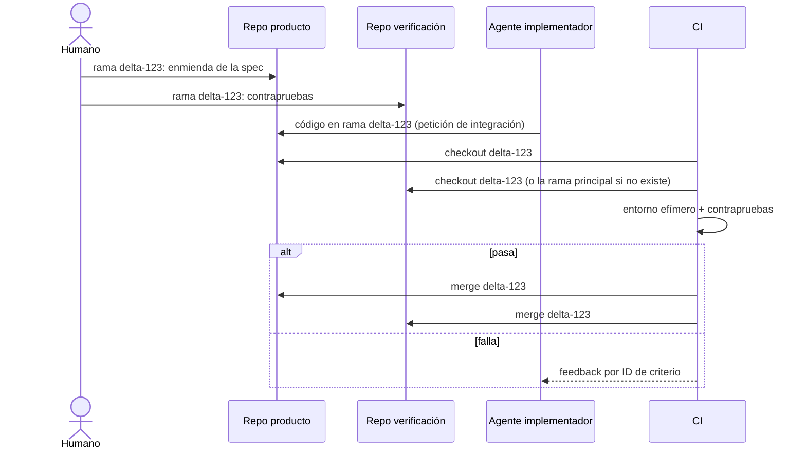
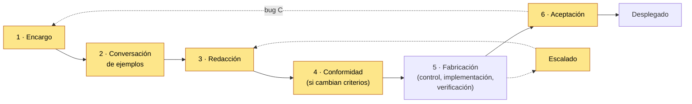

# Desarrollo Guiado por Contrapruebas (DGC)

**Propuesta v0.1** · Octubre de 2026
**Autor:** Juanjo Lozano Gómez ([j2logo](https://j2logo.com))
**Página del método:** [Desarrollo Guiado por Contrapruebas](https://j2logo.com/desarrollo-guiado-por-contrapruebas-dgc/)
**Estado:** propuesta v0.1. Se está validando en **MaIA**, su implementación de referencia, una software factory de agentes.
**Licencia:** [CC BY-SA 4.0](https://creativecommons.org/licenses/by-sa/4.0/deed.es). Puedes usar, adaptar y redistribuir este texto siempre que cites la autoría y publiques las versiones derivadas con esta misma licencia.

---

## Resumen

El **Desarrollo Guiado por Contrapruebas (DGC)** es una metodología para construir software en la que el código lo escriben agentes de IA y nadie lo edita a mano. Se apoya en tres ideas:

1. **La especificación es la única fuente de verdad.** El sistema se describe como un conjunto de **capacidades** versionadas, y el código se deriva de ellas.
2. **La verificación es independiente de quien implementa.** Cada criterio de la spec se comprueba con **contrapruebas**: ejemplos concretos que decide una persona (los escribe o los aprueba), que se ejecutan contra el sistema desde fuera y que el agente implementador **nunca ve**.
3. **El trabajo avanza por deltas.** Cada cambio es un **delta** tipado (adición, enmienda, bug, refactor o cimientos) que modifica la spec y sus contrapruebas antes de tocar una sola línea de código.

La analogía que lo resume: el agente estudia el temario (la spec), pero no conoce las preguntas del examen (las contrapruebas).

A diferencia de las metodologías ágiles, DGC organiza el trabajo de las personas alrededor de lo que ahora es lento, que ya no es construir, sino **entender, especificar y verificar**.

---

## Índice

1. [El problema](#1-el-problema)
2. [Principios](#2-principios)
3. [Glosario](#3-glosario)
4. [El modelo: sistema y capacidades](#4-el-modelo-sistema-y-capacidades)
5. [Contrapruebas](#5-contrapruebas)
6. [Deltas: tipos de cambio](#6-deltas-tipos-de-cambio)
7. [El ciclo](#7-el-ciclo)
8. [Organización del trabajo](#8-organización-del-trabajo)
9. [Operar la factory: recorrido, responsabilidades y métricas](#9-operar-la-factory-recorrido-responsabilidades-y-métricas)
10. [Retirar la revisión humana sin saltos de fe](#10-retirar-la-revisión-humana-sin-saltos-de-fe)
11. [Aplicar DGC en proyectos existentes](#11-aplicar-dgc-en-proyectos-existentes)
12. [Influencias y qué aporta DGC](#12-influencias-y-qué-aporta-dgc)
13. [Limitaciones y preguntas abiertas](#13-limitaciones-y-preguntas-abiertas)
14. [Referencias](#14-referencias)

---

## 1. El problema

Los agentes de IA escriben código funcional a gran velocidad. El cuello de botella se ha desplazado: ya no está en **escribir** el código, sino en **saber si es correcto**.

Las respuestas habituales tienen problemas:

- **Revisar el código a mano** no escala. Cuanto más produce el agente, más tiempo pasa el humano leyendo, y la revisión se vuelve superficial.
- **Dejar que el agente escriba sus propios tests** no sirve como autoridad. El que implementa y el que comprueba comparten la misma interpretación de la tarea, y si la malinterpreta, los tests pasan igual. Además, un agente optimiza para que los tests pasen, no necesariamente para que el sistema haga lo que debe.
- **Spec-driven development (SDD)** mejora mucho el punto de partida, porque el agente trabaja con una especificación explícita. Pero no dice cómo verificar que el resultado la cumple.

DGC propone que la verificación funcione como un examen: una autoridad **independiente** del implementador, escrita a partir de la spec por quien entiende el negocio, y **oculta** a quien escribe el código.

### 1.1 La velocidad sin verificación se pierde en retrabajo

Que la IA genera código más rápido no se discute. Lo que no está claro es que eso se traduzca en entregar más software útil. Los datos disponibles apuntan a lo contrario:

- **METR (2025).** En un ensayo controlado con desarrolladores experimentados trabajando en sus propios repositorios, los que usaban IA fueron un **19 % más lentos**, aunque creían haber ido más rápido.
- **DORA (2025).** El 90 % de los desarrolladores usa IA y el rendimiento de entrega mejora, pero **la inestabilidad de las entregas sigue creciendo**. El 30 % confía poco o nada en el código generado.
- **Stack Overflow (2025).** El 46 % de los desarrolladores desconfía de la precisión de la IA, frente al 31 % del año anterior. La frustración más citada (66 %) son las respuestas "casi correctas, pero no del todo".
- **McKinsey (septiembre de 2026).** Solo alrededor de una cuarta parte de las empresas ve una aceleración significativa, y en un 30 % la productividad bajó después de adoptar agentes.

La explicación más probable es que **lo que se gana generando se pierde revisando, corrigiendo y deshaciendo**. Y los agentes, además, tienden a optimizar para las pruebas que ven:

- en **ImpossibleBench** (2025), cuando los tests contradicen la descripción de la tarea, los modelos más avanzados hacen trampa en más de la mitad de los casos;
- en **SpecBench** (2026), la diferencia entre los tests visibles y los reservados llega a 27–48 puntos;
- en **"Building to the Test"** (Microsoft, 2026), con solo saber si pasan o fallan y el nombre de cada test, los agentes llegan a pasar todos sin construir lo que se pidió.

Por eso DGC no se presenta como una forma de ir más rápido, sino como una forma de que **la velocidad que ya existe deje de perderse en retrabajo**.

### 1.2 El límite de acelerar solo la escritura

Si escribir código ocupa, por ejemplo, un tercio del tiempo de un desarrollador, hacerlo instantáneo solo multiplica la velocidad total por 1,5 mientras el resto siga igual. Es la ley de Amdahl aplicada al desarrollo. La ganancia grande solo aparece si también se aceleran las otras partes: **entender qué se quiere, especificarlo y verificarlo**. DGC actúa precisamente sobre ellas.

### 1.3 Qué busca DGC

- **Que la velocidad de fabricación llegue a producción** sin pasar por una revisión manual que no escala.
- **Paralelismo:** una persona lleva varios deltas a la vez, porque la fabricación es asíncrona. No va más rápido en cada uno, pero entrega más en total.
- **Coste:** hacer con un equipo pequeño y agentes lo que antes necesitaba un equipo mayor.
- **Conocimiento que no se pierde:** la spec y las contrapruebas son documentación viva y verificada. Si alguien se va del equipo, el sistema sigue explicado.
- **Poder rehacer:** si la spec es la fuente de verdad, reescribir un módulo o cambiar de stack pasa a ser viable.

**DGC no promete un porcentaje de mejora.** Lo mide: la métrica de referencia es el tiempo de encargo a delta aceptado (§9.8), antes y después, en una zona concreta del sistema.

---

## 2. Principios

| # | Principio |
|---|---|
| **P1** | **La spec es la única fuente de verdad.** El código es un derivado y no se edita a mano. Si spec y código discrepan, el que está mal es el código. |
| **P2** | **El sistema es la composición ordenada de sus capacidades.** Su comportamiento actual es el resultado de aplicar en orden todos los deltas que se han hecho sobre ellas. |
| **P3** | **La verificación es independiente del implementador.** Las contrapruebas las decide una persona, que las escribe o las aprueba, y el agente implementador no puede leerlas. |
| **P4** | **La dependencia va en un solo sentido: contraprueba → criterio.** La spec no sabe nada de sus contrapruebas. |
| **P5** | **Todo bug es una contraprueba que faltaba.** Corregir un bug sin añadir la contraprueba deja el problema a medias. |
| **P6** | **El feedback habla el lenguaje de la spec, no el de la prueba.** Al implementador se le dice qué criterio no cumple, no qué ejemplo concreto falló. |
| **P7** | **Todo bucle termina.** O converge, o escala a un humano. |
| **P8** | **Verificar antes de validar.** Primero se comprueba que está construido como dice la spec (verificación) y después que es lo que el usuario necesita (validación). |
| **P9** | **El proceso se organiza alrededor del tiempo humano, no del tiempo de construcción.** Los agentes no necesitan coordinarse en reuniones ni tienen límite de trabajo en curso. Las personas, sí. |

---

## 3. Glosario

### 3.1 Modelo y verificación

| Término | Definición |
|---|---|
| **Spec de sistema** | Documento único con lo que afecta a todo el sistema: stack, arquitectura, decisiones técnicas globales y restricciones transversales. |
| **Capacidad** | Unidad de comportamiento con identidad propia que perdura en el tiempo. Contiene propósito, contrato, criterios de aceptación y restricciones. Ejemplo: `recuperacion-password`. |
| **Revisión** | Cada estado de una capacidad (r1, r2, r3…). La revisión vigente es la que manda. |
| **Historial** | Registro de qué criterios y restricciones cambiaron en cada revisión. |
| **Criterio de aceptación** | Regla de comportamiento, con ID (`RP.2`). Dice *qué* hace el sistema y *cuándo*. |
| **Restricción** | Cualidad medible desde fuera, con ID (`RP.R1`): rendimiento, seguridad, límites. Dice *con qué calidad* y *dentro de qué límites*. |
| **Decisión técnica** | Una elección sobre *cómo* se construye (por ejemplo, "los endpoints no acceden a la base de datos"). Va en la spec de sistema. |
| **Contrato** | Interfaz pública que fija la spec: endpoints, comandos, elementos de interfaz. Es lo que permite escribir contrapruebas antes de que exista el código. |
| **Contraprueba** | Ejemplo concreto y ejecutable que pone a prueba un criterio o una restricción contra el sistema en marcha. El implementador no la ve. |
| **Contraprueba funcional** | Comprueba un criterio de aceptación desde la interfaz pública. |
| **Contraprueba técnica** | Comprueba una restricción o decisión técnica (reglas de arquitectura, pruebas de carga, análisis de seguridad). Puede ser visible. |
| **Contraprueba de caracterización** | Fija el comportamiento *actual* de un sistema heredado sin juzgar si es correcto. |
| **Contraprueba quemada** | Contraprueba cuyo contenido se ha revelado al implementador. Pasa a ser un test visible de regresión y se sustituye por otra nueva. |
| **Delta** | Conjunto ordenado de cambios sobre una o varias capacidades (o sobre la spec de sistema), junto con sus contrapruebas. Un encargo = un delta. |
| **Adición** | Cambio que solo añade capacidades, criterios o restricciones. |
| **Enmienda** | Cambio que modifica criterios o restricciones existentes, o la spec de sistema. |
| **Derogación** | Cambio que elimina capacidades, criterios o restricciones. |
| **Escalado** | Detener un delta y devolverlo a un humano cuando el bucle no converge. |
| **Agente implementador** | Escribe el código del producto. Ve la spec, pero no las contrapruebas. |
| **Agente verificador** | Convierte las contrapruebas en código ejecutable. Ve la spec y el contrato, pero nunca el código del implementador. |

### 3.2 Recorrido y responsabilidades

| Término | Definición |
|---|---|
| **Encargo** | Necesidad de negocio que el PO define con los stakeholders: problema, motivo, criterio de éxito y prioridad. Se registra como task. |
| **Conversación de ejemplos** | Conversación breve entre PO y desarrollador en la que se buscan ejemplos concretos, reglas y casos límite del encargo. No se escribe la spec. |
| **Redacción** | Trabajo del desarrollador que convierte el encargo y sus ejemplos en un delta: capacidades, criterios, restricciones y contrapruebas. |
| **Conformidad** | Visto bueno a los criterios y escenarios redactados, antes de fabricar, por alguien que conoce el negocio y no los ha redactado (normalmente el PO). Solo en los deltas que cambian criterios o restricciones. |
| **Fabricación** | Ejecución de control, implementación y verificación, a cargo de los agentes y el CI. |
| **Aceptación** | Comprobación del criterio de éxito de negocio con los stakeholders. Es el momento en que se valida (P8). |
| **Límite WIP** | Número máximo de deltas en un mismo momento humano del recorrido. |
| **Resolución de escalados** | Análisis de un escalado en cuanto aparece, a cargo del responsable del delta, que corrige el artefacto que falló y anota la causa. |
| **Responsable de verificación** | Mantiene la librería de pasos y el entorno efímero, y audita al verificador. |
| **Responsable de sistema** | Mantiene la spec de sistema y protege el pipeline. |
| **Operador de la factory** | Cuida el flujo, los límites WIP, los escalados abiertos, las métricas y el coste de los agentes. |

---

## 4. El modelo: sistema y capacidades

### 4.1 Dos niveles



- La **spec de sistema** recoge lo que vale para todo: el stack, la arquitectura, las decisiones técnicas y las restricciones transversales (por ejemplo, "toda respuesta en menos de 500 ms"). Sin este nivel, las reglas globales acabarían repetidas en todas las capacidades o en ninguna.
- Las **capacidades** describen comportamiento. Una capacidad puede ser una funcionalidad visible para el usuario o un requisito técnico propio de esa capacidad (por ejemplo, "reintentos al llamar a la API externa de pagos").
- Las **flechas punteadas van de la contraprueba a la spec, nunca al revés** (P4).

### 4.2 Qué va en la spec: qué, cuándo, cómo de bien y cómo

En SDD suele decirse que la spec describe el *qué* y no el *cómo*. DGC mantiene esa idea, pero aclara que seguridad, rendimiento o límites **forman parte del qué**, porque se pueden observar desde fuera.

| Tipo | Pregunta | Ejemplo | Dónde va |
|---|---|---|---|
| **Criterio de aceptación** | ¿Qué hace y cuándo? | "Si el email existe, se envía un enlace de recuperación" | Capacidad |
| **Restricción** | ¿Con qué calidad y dentro de qué límites? | "En menos de 1 minuto; máximo 5 solicitudes por hora" | Capacidad (o sistema, si es transversal) |
| **Decisión técnica** | ¿Cómo se construye? | "Los endpoints no acceden directamente a la base de datos" | Spec de sistema |

**Regla práctica:** si algo se puede medir u observar sin mirar el código, es una restricción. Si dicta cómo se construye, es una decisión técnica.

**Condición frente a restricción:** las condiciones en las que se da un comportamiento (el "Dado…") forman parte del criterio. Las restricciones describen la calidad de ese comportamiento. Mantenerlas separadas importa porque se verifican de forma distinta.

### 4.3 La ficha de una capacidad

| Campo | Contenido |
|---|---|
| **ID y nombre** | Slug estable y legible (`recuperacion-password`). |
| **Prefijo** | Abreviatura con la que empiezan los IDs de sus criterios y restricciones (`RP`). Recomendado; ver *Identificadores*. |
| **Estado y revisión** | Propuesta / activa / derogada. Revisión vigente. |
| **Propósito** | Para quién es y por qué existe. Ayuda al agente a decidir en casos que la spec no prevé. |
| **Contrato** | Interfaz pública: endpoints, comandos, elementos de interfaz y cómo se localizan. |
| **Criterios de aceptación** | Reglas con ID. Se recomienda una sintaxis tipo EARS: *"Cuando [disparador], el sistema deberá [respuesta]"*. |
| **Restricciones** | Cualidades medibles con ID. |
| **Fuera de alcance** | Lo que expresamente *no* hace. Evita que el agente invente funcionalidad. |
| **Dependencias** | Otras capacidades de las que depende. |
| **Dudas abiertas** | Lo que aún no está decidido. Mejor escrito que adivinado. |
| **Historial** | Qué criterios y restricciones se añadieron, enmendaron o derogaron en cada revisión, y en qué delta. **No menciona las contrapruebas.** |

Ejemplo:

```markdown
---
id: recuperacion-password
nombre: Recuperación de contraseña
prefijo: RP
estado: activa
revision: 3
---

## Propósito
Permitir que un usuario registrado recupere el acceso a su cuenta
sin intervención de soporte.

## Contrato
- POST /auth/password-recovery   { email }
- POST /auth/password-reset      { token, nueva_password }

## Criterios de aceptación
- RP.1 Cuando un usuario solicite recuperar la contraseña con un email
       registrado, el sistema deberá enviarle un enlace de recuperación.
- RP.2 El enlace deberá caducar 30 minutos después de su emisión.
- RP.3 El enlace deberá ser de un solo uso.
- RP.4 Si el email no está registrado, el sistema deberá responder
       exactamente igual que en RP.1.

## Restricciones
- RP.R1 El correo deberá enviarse en menos de 1 minuto.
- RP.R2 Máximo 5 solicitudes por email y hora.

## Fuera de alcance
- Recuperación por SMS.
- Desbloqueo de cuentas bloqueadas por seguridad.

## Dependencias
- alta-usuario

## Dudas abiertas
- ¿Se invalida la sesión activa al cambiar la contraseña?

## Historial
- r3 (Δ-123): enmienda RP.2 — caducidad de 60 a 30 minutos.
- r2 (Δ-087): adición de RP.4.
- r1 (Δ-041): creación.
```

#### Identificadores

Criterios y restricciones llevan un ID que las contrapruebas usan para apuntarles (P4). DGC no impone un formato, pero recomienda una convención como la de los ejemplos:

| Elemento | Formato | Ejemplo |
|---|---|---|
| Criterio de aceptación | `<prefijo>.<número>` | `RP.2` |
| Restricción | `<prefijo>.R<número>` | `RP.R1` |

Distinguir el tipo en el propio ID tiene una ventaja práctica: criterios y restricciones se verifican de forma distinta (los criterios con contrapruebas funcionales, siempre ocultas; las restricciones, normalmente con contrapruebas técnicas, que pueden ser visibles), y el CI puede tratarlos por separado sin consultar la ficha. Además, cada tipo tiene su propia numeración y no chocan entre sí.

Sea cual sea el formato elegido, se recomiendan tres reglas, porque son las que permiten que la trazabilidad y la detección de contrapruebas huérfanas (§5.4) funcionen:

1. **IDs estables.** Un criterio enmendado conserva su ID: `RP.2` sigue siendo `RP.2` aunque la caducidad pase de 60 a 30 minutos. No se renumera.
2. **IDs derogados no reutilizados.** Si se elimina `RP.3`, el siguiente criterio será `RP.5`. Si se reutilizara, una contraprueba antigua podría apuntar a un criterio nuevo sin relación con ella, y nadie lo detectaría.
3. **Prefijo único en el sistema.** Dos letras chocan con facilidad (`recuperacion-password` y `registro-proveedores`). Se puede declarar el prefijo en la ficha (campo `prefijo`) y comprobar en el CI que no se repite, o usar el slug completo (`recuperacion-password.R1`), más largo pero sin posibilidad de choque.

### 4.4 Historial: el sistema como composición de deltas

Una capacidad **conserva su identidad aunque cambie su contenido**. `recuperacion-password` r1 → r2 → r3 sigue siendo la misma capacidad. El comportamiento del sistema en cada momento es el resultado de aplicar en orden todos los deltas, igual que el esquema de una base de datos es el resultado de aplicar sus migraciones.



Se guardan **las dos cosas**:

- **El estado vigente**: el fichero de cada capacidad tal como está hoy. Es lo que lee cualquiera, persona o agente, para saber qué es verdad.
- **Los deltas**: el historial del control de versiones más la sección *Historial* de la ficha, que recoge la intención de cada cambio, algo que un diff no muestra.

Con una enmienda pueden dejar de ser válidas contrapruebas de revisiones anteriores. Por eso **la relación entre criterios y contrapruebas no es 1:1 a lo largo del tiempo**: el conjunto de contrapruebas vigente tiene que reflejar el estado actual de la spec, no la suma de todas las que se han escrito.

---

## 5. Contrapruebas

### 5.1 Qué es una contraprueba

Una contraprueba es un **ejemplo concreto** que pone a prueba un criterio. Si el criterio es la regla, la contraprueba es una pregunta de examen sobre esa regla.

- Es de **caja negra**: actúa sobre la interfaz pública (peticiones HTTP, CLI o un navegador automatizado) y no importa código interno.
- Se recomienda escribirla con la estructura **Dado / Cuando / Entonces**, por ejemplo en Gherkin: es un formato que pueden leer el PO y el desarrollador, y que muchas herramientas saben ejecutar. El formato concreto, el nombre de los ficheros y la herramienta que los ejecuta son elección de cada equipo.
- Lleva el **ID del criterio** que verifica (en Gherkin, como etiqueta del escenario).

```gherkin
# language: es
Característica: Recuperación de contraseña

  @RP.2
  Escenario: Enlace usado justo antes de caducar
    Dado un enlace de recuperación emitido a las 10:00
    Cuando se usa a las 10:29
    Entonces la contraseña se puede cambiar

  @RP.2
  Escenario: Enlace caducado
    Dado un enlace de recuperación emitido a las 10:00
    Cuando se usa a las 10:31
    Entonces se rechaza por enlace caducado

  @RP.3
  Escenario: Enlace reutilizado
    Dado un enlace de recuperación ya utilizado
    Cuando se intenta usar de nuevo
    Entonces se rechaza por enlace ya usado
```

Un criterio suele tener varias contrapruebas, sobre todo en los casos límite. Los criterios **no** se escriben como escenarios: los escenarios sirven para ejemplos, no para reglas.

### 5.2 Tipos de contraprueba

Hay dos clasificaciones distintas:

| Según lo que comprueban | Qué verifican | Ejemplos | ¿Ocultas? |
|---|---|---|---|
| **Funcionales** | Criterios de aceptación | "Con un enlace caducado, la API devuelve 410" | **Sí, siempre** |
| **Técnicas** | Restricciones y decisiones técnicas | Una regla de dependencias entre módulos ("`api` no importa `db`"); prueba de carga p95 < 200 ms; escáner de secretos y dependencias | **Pueden ser visibles**: la regla misma es la prueba y no hay ejemplos que memorizar |

| Según su origen | Cuándo se escriben | Para qué |
|---|---|---|
| **Diseñadas** | A partir de la spec, antes de implementar | Caso normal |
| **De caracterización** | Observando lo que hace hoy un sistema heredado | Red de seguridad: avisan si el agente cambia un comportamiento que nadie ha documentado. Cuando se confirma el comportamiento en la spec, pasan a ser diseñadas |

### 5.3 Quién escribe qué



| Quién | Qué escribe | Qué ve | Qué no ve |
|---|---|---|---|
| **Humano** | Spec y escenarios. Puede aprobar escenarios que le propone un agente, pero la decisión es suya. | Todo | — |
| **Agente verificador** | *Step definitions*: el código que ejecuta cada paso de los escenarios | Spec, contrato y escenarios | Código del producto |
| **Agente implementador** | Código del producto y sus tests propios (unitarios, de integración) | Spec y contrapruebas técnicas visibles | Contrapruebas funcionales |

**Por qué el humano escribe los ejemplos:** si un agente generase los escenarios a partir de la spec, las contrapruebas dependerían de *su* interpretación. Ante una spec ambigua, implementador y verificador podrían malinterpretarla igual, y la contraprueba pasaría. Los ejemplos son el punto donde el criterio humano aporta más valor. Traducirlos a código es mecánico.

**Si un agente propone escenarios**, la persona sigue decidiendo cuáles se aceptan, y ese agente no puede ser el implementador ni compartir su contexto. De lo contrario, las contrapruebas volverían a depender de la misma interpretación que el código.

**Tests del implementador frente a contrapruebas:** son niveles distintos que no deben mezclarse. La spec define criterios (el qué). Los tests unitarios forman parte del *cómo* y los escribe el implementador junto a su código. Las contrapruebas se derivan de los criterios, no de la implementación.

### 5.4 Reglas de las contrapruebas

1. **Aislamiento.** Implementador y verificador son agentes distintos, con contextos distintos. Si los dos papeles los hace el mismo agente, la contraprueba deja de ser independiente.
2. **Derivabilidad.** Toda contraprueba debe poder deducirse de un criterio escrito en la spec. Si comprueba algo que la spec no dice, el agente no puede acertarla y el feedback no le sirve. Una contraprueba no derivable señala un hueco en la spec.
3. **Vínculo por ID de criterio.** Cada contraprueba lleva el ID del criterio que verifica. Es el único vínculo entre ambas.
4. **Ejecución de control.** Antes de implementar, se ejecutan las contrapruebas contra el sistema actual:
   - las de comportamiento **nuevo** deben **fallar**; si pasan, no comprueban nada y se descartan;
   - las de **caracterización** deben **pasar**.
5. **Consistencia automática.** El CI comprueba de forma continua:
   - **contrapruebas huérfanas**: apuntan a un criterio que ya no existe → se retiran;
   - **criterios sin cubrir**: no tienen ninguna contraprueba → aviso.

### 5.5 ¿Quién verifica al verificador?

Un *step definition* puede estar mal sin que se note: un assert que no comprueba nada, un mock que sustituye al sistema real, una comparación demasiado laxa. Defensas:

- **La ejecución de control** (regla 4) es la más barata y detecta las contrapruebas que no comprueban nada.
- **Revisar los *step definitions***, sobre todo al principio. El volumen es pequeño y decrece: los pasos forman una librería reutilizable ("Dado un usuario registrado", "Cuando hace POST a…"), y con el tiempo la mayoría de escenarios nuevos reutilizan pasos ya revisados. Se cambia revisar todo el código del producto por revisar una librería pequeña que se estabiliza.
- **Mutation testing** de forma puntual: se introducen fallos a propósito en el código y se mide si las contrapruebas los detectan.

---

## 6. Deltas: tipos de cambio

Un **delta** es la unidad de cambio. Cada encargo produce un delta. Todo delta modifica primero la spec y las contrapruebas, y después se deriva el código.

| Tipo | Qué cambia en la spec | Qué cambia en las contrapruebas | Ejemplo |
|---|---|---|---|
| **Adición** | Nueva capacidad, nuevos criterios o nuevas restricciones | Nuevas: funcionales para los criterios, técnicas para las restricciones | "Añadir recuperación de contraseña" |
| **Enmienda** | Criterios o restricciones modificados | Se reescriben las afectadas; las huérfanas se retiran | "La caducidad pasa de 60 a 30 min" |
| **Derogación** | Se eliminan capacidades, criterios o restricciones | Quedan huérfanas y se retiran | "Eliminar el login con usuario y contraseña" |
| **Bug** | Depende del tipo (abajo) | **Siempre se añade la que faltaba** (P5) | — |
| **Refactor** | Ninguno | **Las funcionales no cambian: deben pasar todas, sin tocarlas** | "Separar el módulo de pagos" |
| **Cimientos** | Spec de sistema | Técnicas | Scaffolding inicial, fichero de dependencias, CI, actualizar la versión del lenguaje |

### 6.1 Bugs

Un bug no es un tipo de artefacto aparte, sino algo que hay que **clasificar**:

| Tipo | Qué falló | Qué se hace |
|---|---|---|
| **A. El código no cumple la spec** y ninguna contraprueba lo detectó | Faltaba una contraprueba | Se añade la contraprueba que reproduce el bug. La spec no cambia. El implementador corrige contra la spec vigente. |
| **B. La spec era ambigua o incompleta** | Faltaba precisión | Enmienda que aclara el criterio, con su contraprueba. |
| **C. El sistema cumple la spec, pero la spec estaba mal** | Validación | Enmienda, como cualquier cambio de requisito. |

En el tipo A, el código cambia sin que cambie la spec. Es un delta sin cambios en la spec, cuyo desencadenante es una contraprueba nueva.

### 6.2 Refactors

Un refactor es un delta que **no modifica ninguna contraprueba funcional**: todas las existentes deben seguir pasando sin cambios.

- **Mejora de rendimiento:** en realidad es una enmienda de una restricción ("p95 < 200 ms"), con su contraprueba técnica.
- **Legibilidad y extensibilidad:** no cambian la spec. Que nadie lea el código no los hace irrelevantes: el que lee el código es el agente, y un código enredado reduce su tasa de acierto en los deltas siguientes. Se verifican con métricas de código (complejidad, acoplamiento) como contrapruebas técnicas. *(Pendiente de diseñar en detalle, ver §13.)*

### 6.3 Cimientos

El scaffolding del proyecto, el fichero de dependencias, la estructura de carpetas o el pipeline de CI son la implementación de la **spec de sistema**. El primer delta de un proyecto es un **delta de cimientos**, con contrapruebas técnicas:

- las dependencias se instalan;
- el linter pasa;
- la aplicación arranca y el healthcheck responde;
- el CI se ejecuta.

Un cambio posterior de stack o de herramientas es una enmienda a la spec de sistema.

### 6.4 Efecto sobre datos existentes

En cuanto un sistema está en producción, hay datos que se crearon con revisiones anteriores de la spec. **Toda enmienda debe indicar qué pasa con esos datos** y, si hace falta, incluir una migración con su propia contraprueba.

---

## 7. El ciclo

Esta sección describe el ciclo técnico de un delta. Quién interviene en cada momento y cómo se organizan las personas está en §9.



1. **Encargo.** El Product Owner y los stakeholders describen una necesidad en su lenguaje.
2. **Conversación de ejemplos.** PO y desarrollador buscan ejemplos, reglas y casos límite.
3. **Redacción.** El desarrollador traduce el encargo en un delta: qué capacidades se crean, enmiendan o derogan, y sus contrapruebas. Spec y contrapruebas se escriben juntas, como parte del mismo delta.
4. **Conformidad.** Si el delta cambia criterios o restricciones, alguien que conoce el negocio y no los ha redactado, normalmente el PO, da el visto bueno a criterios y escenarios (§9.2).
5. **Step definitions.** El agente verificador escribe el código de las contrapruebas.
6. **Ejecución de control.** Las contrapruebas nuevas deben fallar contra el sistema actual.
7. **Implementación.** El agente implementador recibe la spec vigente y los cambios del delta.
8. **Verificación en CI.** Tests propios, contrapruebas técnicas y contrapruebas funcionales, en un entorno efímero.
9. **Feedback** si falla (§7.1).
10. **Aceptación.** Se comprueba con los criterios de éxito de negocio del encargo. Si no se cumplen, es un bug tipo C y se vuelve al encargo.
11. **Despliegue.**

### 7.1 Feedback por niveles

Si el implementador recibe el detalle de la contraprueba que falló ("el escenario X esperaba Y"), el agente la conoce: deja de ser una contraprueba y empieza a sobreajustarse a ella. Es el mismo error que ajustar un modelo de ML con el conjunto de test. Por eso el feedback avanza por niveles:



1. **Nivel 1.** ID del criterio, su texto y el tipo de fallo ("RP.2: rechazó cuando debía aceptar"). No revela el ejemplo y basta en la mayoría de casos.
2. **Nivel 2: quemar la contraprueba.** Si tras N intentos sigue fallando, se revela ese ejemplo concreto. Desde ese momento pasa a ser un test visible de regresión, y se escribe una contraprueba nueva que la sustituya. Quemar tiene un coste, y el nombre lo deja claro.
3. **Escalado.** Si se supera el límite, el delta se detiene y vuelve a un humano. Un fallo persistente suele indicar que la spec es ambigua (bug tipo B) o que la contraprueba está mal, no que el agente sea torpe.

Incluso el nivel 1 filtra información: la investigación muestra que conocer solo qué pasa y qué falla basta para que un agente se ajuste a las pruebas (§1.1). Por eso el número de intentos N debe ser bajo y el feedback no debe incluir nombres de escenarios.

---

## 8. Organización del trabajo

> DGC distingue entre **principios** y **prácticas**. Los principios (§2) son obligatorios: por ejemplo, que el implementador no pueda acceder a las contrapruebas funcionales. Las prácticas de esta sección (repositorios, rama de delta, pipeline) son la forma que el método recomienda para cumplirlos. Cada equipo puede elegir otra, siempre que garantice lo mismo.

### 8.1 Encargo frente a capacidad

- **El encargo describe una necesidad.** Es temporal y se cierra. Se registra como task en la herramienta de gestión.
- **La capacidad describe el sistema.** Es permanente.

El encargo lo definen el PO y los stakeholders sin hablar de capacidades. Las capacidades se vinculan durante la **redacción**, y crear una nueva es uno de los resultados posibles. Por eso no importa que una capacidad aún no exista cuando se hace el encargo.

| Campo de la task | Quién lo rellena |
|---|---|
| Necesidad o problema, quién lo pide, valor, prioridad | PO y stakeholders |
| **Criterios de éxito de negocio** (cómo sabrán ellos que está bien) | PO y stakeholders. Se usan en la **aceptación** |
| Tipo de delta | Desarrollador, en la redacción |
| Capacidades afectadas | Desarrollador, en la redacción |
| Estado | El recorrido (§9.2) |

Las tasks pueden vivir en una herramienta de gestión (Notion, Jira…). Las specs **no**: viven en el repositorio.

### 8.2 Repositorios

Una organización posible:

```text
mi-app/                         ← repositorio del producto (el agente tiene acceso)
  specs/
    sistema.md                  ← stack, arquitectura, restricciones globales
    capacidades/
      recuperacion-password.md  ← una ficha por capacidad
      facturacion.md
  src/
  tests/                        ← tests propios del implementador (visibles)
  <reglas de arquitectura>      ← contrapruebas técnicas visibles
  <fichero de dependencias>
  <contexto del agente>         ← instrucciones para el agente; apunta a specs/sistema.md

mi-app-verificacion/            ← repositorio privado (solo humanos y CI)
  funcionales/                  ← contrapruebas, en el formato elegido
    recuperacion-password.*
    facturacion.*
  steps/                        ← step definitions (agente verificador)
  tecnicas/                     ← pruebas de carga, seguridad…
  entorno/                      ← definición del entorno efímero, datos semilla, dobles de APIs
```

- **Las specs van en el mismo repo que el código.** Si la spec es la fuente de verdad, tiene que versionarse junto al código que deriva de ella: un mismo cambio versionado incluye spec y código, y el implementador necesita leerla.
- **Las contrapruebas funcionales van en un repo aparte**, al que el implementador no tiene acceso.

Por qué un repo aparte y no otras opciones:

| Opción | Barrera real | Comentario |
|---|---|---|
| **Repo aparte sin acceso para el agente** | **Sí** | Recomendada. |
| Mismo repo con reglas de denegación en la configuración del agente (p. ej. `deny Read(./verificacion/**)`) | No | Es una norma, no una barrera. El agente también puede usar las herramientas del sistema (`grep`, `cat`…), y al buscar en el repo se las encontrará sin querer. El riesgo real no es la trampa deliberada, sino la lectura accidental. |
| Mismo repo con ficheros cifrados (p. ej. git-crypt o sops) | Parcial | Solo funciona si el agente trabaja en un entorno sin la clave. En una máquina con el repo descifrado, lo ve todo. |

### 8.3 Vincular los dos repos: la rama de delta

Con dos repos, "la versión vigente" deja de estar clara mientras hay trabajo en curso. Si se suben las contrapruebas de un delta a la rama principal de verificación antes de que su código esté integrado, cualquier petición de integración que no tenga nada que ver fallaría.

La solución no necesita números de revisión manuales: **el vínculo es el delta**.



- Los cambios de spec van en la rama `delta-123` del repo de producto, y las contrapruebas en la rama `delta-123` del repo de verificación.
- Al verificar una petición de integración, el CI usa la rama del mismo nombre en el repositorio de verificación si existe, y si no, la rama principal.
- Al integrar el cambio del producto, el CI integra también la rama de verificación.

Se describe con ramas porque es lo habitual. Cualquier mecanismo que vincule por delta los cambios de los dos repositorios sirve igual.

### 8.4 El pipeline de verificación

1. El implementador abre una petición de integración (*pull request*, *merge request* o equivalente).
2. El CI construye el artefacto (por ejemplo, una imagen de contenedor).
3. El CI levanta un **entorno efímero**: base de datos, **dobles de las APIs externas** y **datos semilla** representativos.
4. El CI descarga las contrapruebas con un token que el agente no tiene.
5. Ejecuta tests propios, contrapruebas técnicas y contrapruebas funcionales.
6. Genera un informe por **ID de criterio**.

**El CI es la autoridad.** Las contrapruebas pueden ejecutarse también en local con el mismo comando, pero solo el CI garantiza que estén fuera del alcance del agente. Producción no sirve para verificar: sirve para validar y monitorizar.

**Proteger el pipeline.** Si la configuración del CI vive en el repo del producto, el agente puede modificarla y saltarse la verificación. Hay que protegerla con los mecanismos de la plataforma (propietarios obligatorios de esos ficheros, protección de ramas) o definir la verificación fuera del repo del producto. Los logs del CI tampoco deben mostrar el contenido de las contrapruebas al agente.

**Lo que las contrapruebas funcionales no cubren:** verifican comportamiento, no calidad. Hacen falta además gates automáticos: linters y tipado, análisis estático de seguridad, escaneo de dependencias, reglas de arquitectura (*fitness functions*) y presupuestos de rendimiento.

---

## 9. Operar la factory: recorrido, responsabilidades y métricas

Las secciones anteriores describen *qué* se produce (spec, contrapruebas, código) y *cómo* se verifica. Esta sección describe cómo se organizan las personas alrededor de una factory que trabaja con DGC: quién hace qué, y cuándo.

> Todo lo que describe esta sección es hipótesis de diseño, pendiente de validar con equipos reales.

### 9.1 El cuello de botella se ha movido

Las metodologías ágiles organizan el trabajo alrededor de un hecho: **construir software es lento e incierto**. Las iteraciones, las estimaciones y la velocidad existen para gestionar esa incertidumbre.

En una factory de agentes ese hecho cambia. Implementar un delta bien especificado lleva minutos u horas, no días. Lo lento y lo incierto pasa a ser otra cosa:

- **entender qué hay que construir** (encargo y conversación de ejemplos),
- **escribirlo con precisión** (redacción del delta y sus contrapruebas),
- **resolver lo que el agente no consigue** (escalados),
- **comprobar que lo construido sirve** (aceptación).

Todo eso es trabajo humano, y por eso el proceso se organiza alrededor de él (P9).

DGC no usa iteraciones, estimaciones, reunión diaria ni planificación por ciclos. Hay un recorrido que sigue cada cambio (§9.2) y una sola cita fija (§9.4).

### 9.2 El recorrido de un cambio

La unidad de trabajo es el **delta**. Cada delta sigue el mismo recorrido de seis momentos y se despliega en cuanto lo termina, sin esperar a ningún ciclo.



| Momento | Quién | Duración típica | Resultado |
|---|---|---|---|
| **1. Encargo** | PO con stakeholders | Lo que haga falta | La task: problema, motivo, criterio de éxito de negocio y prioridad |
| **2. Conversación de ejemplos** | PO y desarrollador (y, si hace falta, responsable de verificación) | 30–60 min | Ejemplos concretos, reglas y preguntas resueltas. **Aquí no se escribe la spec: se habla** |
| **3. Redacción** | Desarrollador, a solas | De horas a un día | El delta: revisión de la capacidad, criterios, restricciones y contrapruebas |
| **4. Conformidad** | PO, o quien conozca el negocio y no haya redactado el delta | Minutos, de forma asíncrona | Lee los criterios y escenarios, que están en lenguaje de negocio, y da su visto bueno. Solo en los deltas que cambian criterios o restricciones. **Sin conformidad no se fabrica** |
| **5. Fabricación** | Agentes y CI | Minutos u horas | Ejecución de control, implementación y verificación (§5–§7). El desarrollador solo interviene si hay escalado |
| **6. Aceptación** | PO con stakeholders | Variable | Se comprueba el criterio de éxito de negocio. Si falla, es un bug tipo C y vuelve al encargo |

**Por qué hace falta la conformidad.** El mismo desarrollador redacta la spec y las contrapruebas. Si entiende mal una regla de negocio, el error pasa a las dos a la vez, las contrapruebas pasan y nadie lo detecta hasta producción: es el mismo fallo que DGC evita entre implementador y verificador. La conversación de ejemplos lo reduce, pero lo que se habla y lo que se escribe no siempre coinciden. La conformidad consiste en que alguien que no ha redactado los criterios los lea antes de fabricar. El PO no necesita leer código, pero sí puede leer *"si el pedido está enviado a medias, el cliente solo puede cancelar las líneas no enviadas"*.

**Cómo mantenerla ligera:**

- **Asíncrona:** un visto bueno en la herramienta de gestión o en la revisión del delta, no una reunión.
- **Solo cuando cambian criterios o restricciones:** las adiciones, enmiendas y derogaciones, y los bugs de tipo B y C, la necesitan. Los bugs de tipo A, los refactors y los deltas de cimientos no cambian la spec funcional y pasan directamente a fabricación.
- **Delegable:** puede darla cualquier persona que conozca el negocio y no haya redactado el delta.

Cuando la comunicación entre PO y desarrollador es fluida, la conformidad se reduce a unos minutos. Lo que no conviene es eliminarla: es la única comprobación independiente de la interpretación humana.

**Sin estimaciones.** Estimar el coste de construcción deja de tener sentido cuando construir es barato. Lo que conviene vigilar es el **tamaño del delta** (cuántos criterios toca): un delta grande es más difícil de conversar, de redactar, de verificar y de aceptar. La recomendación es mantenerlos pequeños.

### 9.3 Límites de trabajo en curso

Solo los momentos humanos llevan **límite de trabajo en curso (WIP)**. Los agentes pueden fabricar tantos deltas en paralelo como permita el presupuesto.

| Momento | ¿Límite WIP? |
|---|---|
| Conversación de ejemplos y redacción | **Sí**, por desarrollador |
| Conformidad | **Sí**, para que no se acumulen deltas esperando al PO |
| Fabricación | No |
| Aceptación | **Sí** |
| Escalados abiertos | **Sí, el más estricto** |

**Regla del escalado primero:** un escalado lo resuelve en cuanto aparece el desarrollador responsable del delta (§9.7), antes de empezar conversaciones de ejemplos nuevas. Un escalado es un delta bloqueado y, casi siempre, una señal de que algo en la spec o en las contrapruebas está mal (§7.1). Acumularlos es acumular deuda en la fuente de verdad.

### 9.4 Una sola cita fija

Todo lo demás ocurre cuando hay un encargo o un escalado. Solo hay una cita en el calendario:

| Cita | Cuándo | Quién | Para qué |
|---|---|---|---|
| **Revisión de la factory** | Mensual | Todo el equipo | Revisar las métricas (§9.8), buscar patrones entre las causas de los escalados del periodo (§9.7), decidir si se retira revisión humana en alguna zona (§10) y ajustar la spec de sistema |

Si la tasa de escalado sube de forma brusca, el análisis de patrones se adelanta sin esperar a la cita.

No hay reunión diaria: el tablero muestra en todo momento el estado de cada delta. Si una persona necesita algo de otra, se lo pide.

### 9.5 Responsabilidades

Los roles describen responsabilidades, no puestos. En un equipo pequeño una misma persona puede tener varios; en uno de una sola persona, todos.

| Rol | Responsabilidad | Equivalente aproximado hoy |
|---|---|---|
| **Product Owner** | Hace los encargos con los stakeholders, decide las reglas de negocio en la conversación de ejemplos, da la conformidad y hace la aceptación | Product Owner / Product Manager |
| **Desarrollador** | Conversa los ejemplos con el PO, redacta los deltas (capacidades, criterios, restricciones y contrapruebas), resuelve escalados, caracteriza el código heredado y revisa código mientras no se haya retirado la revisión | Desarrollador, analista funcional |
| **Responsable de verificación** | Mantiene la librería de pasos y el entorno efímero. Revisa los *step definitions* que escribe el agente verificador. Audita al verificador (ejecución de control, mutation testing). Decide cuándo quemar una contraprueba | QA, SDET |
| **Responsable de sistema** | Mantiene la spec de sistema: stack, arquitectura, decisiones técnicas y contrapruebas técnicas. Diseña y protege el pipeline. Lleva los deltas de cimientos | Tech lead, arquitecto |
| **Operador de la factory** | Cuida el flujo: límites WIP, escalados abiertos, métricas y coste de agentes. Prepara la revisión de la factory | Engineering Manager |

#### La frontera entre PO y desarrollador

**El desarrollador pregunta, el PO decide y el desarrollador escribe.**

| | Product Owner | Desarrollador |
|---|---|---|
| Responde a | ¿Qué problema resolvemos y por qué? | ¿Cómo se comporta exactamente y cómo lo comprobamos? |
| Decide | Prioridad, alcance y reglas de negocio | Nada de negocio: lo pregunta |
| Escribe | El encargo y su criterio de éxito | La capacidad, los criterios, las restricciones y las contrapruebas |
| No hace | Redactar criterios ni escenarios | Inventarse reglas de negocio |

*Ejemplo.* El PO encarga: *"los clientes deben poder cancelar un pedido antes del envío"*. El valor del desarrollador está en encontrar lo que falta: ¿y si el pedido está enviado a medias? ¿El reembolso es automático? ¿Qué pasa con el stock? ¿Hay plazo? El PO responde cada pregunta y el desarrollador lo convierte en criterios precisos y en ejemplos que puedan fallar. Ese trabajo de encontrar huecos es el que antes hacía al programar; ahora lo hace antes y por escrito.

#### La semana del desarrollador

La fabricación es asíncrona, así que el desarrollador no espera a que termine un delta: lleva varios a la vez, cada uno en un momento distinto del recorrido. Una distribución orientativa, todavía sin medir:

| Actividad | Proporción aproximada |
|---|---|
| Redactar deltas | ~40 % |
| Conversaciones de ejemplos | ~10–15 % |
| Resolver escalados | ~15 % |
| Revisar código (mientras no se retire, §10) | ~15 %, decreciente |
| Caracterizar código heredado | Variable, según la zona |
| Mejorar la factory (pasos, plantillas, pipeline) | ~10 % |

**Lo que cambia para el desarrollador.** Programar deja de ser su trabajo principal. Su valor pasa a estar en entender el negocio, escribir criterios precisos y encontrar los casos límite que convierten un criterio en buenas contrapruebas. Es un trabajo más cercano al análisis que a la programación, y no todos los desarrolladores lo querrán hacer. Sigue habiendo código escrito o supervisado por personas en la zona heredada (§11.3), en la propia factory y donde el agente tiene un límite real.

**Lo que cambia para el arquitecto.** Gana peso. Un agente amplifica la estructura que encuentra: con una buena spec de sistema produce código coherente, y con una mala produce desorden más rápido.

**Lo que cambia para QA.** Pasa de probar el producto a **garantizar que la autoridad de verificación es fiable**. Es probablemente el rol que más gana en importancia: la confianza en el sistema nunca será mayor que la calidad de sus contrapruebas.

### 9.6 Capacidad del equipo

Como un desarrollador lleva varios deltas en paralelo, la capacidad del equipo ya no la limita cuánto código escribe cada persona, sino **cuántas conversaciones, redacciones, conformidades y escalados puede sostener con calidad**.

Tres consecuencias:

- **El cuello de botella puede desplazarse al PO.** Si los desarrolladores producen deltas más rápido, hacen falta más encargos, conversaciones y conformidades. No está comprobado cómo se resuelve: puede bastar con una conformidad asíncrona y delegable, o puede hacer falta más capacidad de producto en el equipo. El tiempo en espera de conformidad (§9.8) es la métrica que lo indica.
- **El código heredado frena la ganancia.** En un sistema nuevo con una librería de pasos madura, el tiempo por delta puede bajar mucho. En una zona heredada, antes hay que caracterizar, y la ganancia será menor durante meses.
- **La capacidad se mide, no se promete.** DGC no fija cuánto se puede reducir un equipo. Lo determinan la tasa de escalado, la madurez de la librería de pasos, la proporción de código heredado y el tiempo de conformidad. La métrica de referencia es el **tiempo de encargo a delta aceptado** (§9.8).

Cuando hacer software cuesta menos, las organizaciones suelen pedir más software. Es posible que se necesiten menos personas para el mismo trabajo y, aun así, no menos personas en total.

### 9.7 Resolver escalados

Un escalado lo resuelve en cuanto aparece el desarrollador responsable del delta, sin buscar culpables. Identifica qué falló, corrige el artefacto correspondiente y anota la causa:

| Causa | Señal típica | Qué se corrige |
|---|---|---|
| **Spec ambigua o incompleta** (bug tipo B) | El agente entrega algo razonable, pero distinto de lo que se quería | Enmienda del criterio |
| **Contraprueba no derivable** | Comprueba algo que la spec no dice | Se añade a la spec o se retira la contraprueba |
| **Contraprueba o paso mal escrito** | Falla también con un comportamiento correcto | Se corrige el escenario o el *step definition* |
| **Spec de sistema insuficiente** | El agente no sabe cómo encajar el cambio en la arquitectura | Enmienda de la spec de sistema o nueva decisión técnica |
| **Delta demasiado grande** | Falla en varios criterios a la vez y no converge | Se divide en deltas más pequeños |
| **Límite real del agente** | Spec y contrapruebas son correctas y aun así no lo consigue | Se anota; puede justificar implementación asistida en esa zona |

El resultado no es un acta: es un cambio en un artefacto (spec, contraprueba, paso o spec de sistema). Si un escalado no produce ningún cambio, probablemente se repetirá.

Anotar la causa permite ver, en la revisión de la factory (§9.4), patrones que no se aprecian escalado a escalado: una capacidad que escala una y otra vez porque su spec es confusa, un paso de la librería que falla en varios deltas o una decisión técnica que falta en la spec de sistema.

### 9.8 Métricas

La velocidad en puntos de historia deja de tener sentido. Estas métricas miden la salud de la factory:

| Métrica | Qué indica | Señal de alarma |
|---|---|---|
| **Tiempo de encargo a delta aceptado** | Fluidez del trabajo humano de punta a punta | Crece mientras la fabricación se mantiene: el cuello está en conversación, redacción, conformidad o escalados |
| **Tiempo en espera de conformidad** | Carga del PO | Crece de forma sostenida: la conformidad se ha convertido en cuello de botella |
| **Tasa de escalado** (escalados / deltas) | Calidad de las specs y las contrapruebas | Tendencia creciente |
| **Contrapruebas quemadas por delta** | Lo bien que funciona el nivel 1 de feedback | Muchas quemas en la misma capacidad: la spec de esa capacidad es confusa |
| **Bugs en producción por tipo (A/B/C)** | Dónde falla el sistema: cobertura, precisión o validación | Muchos tipo A: faltan contrapruebas. Muchos tipo B: specs vagas. Muchos tipo C: la conversación de ejemplos no entiende el negocio |
| **Deltas sin revisión humana del código** (%) | Confianza acumulada en la verificación | — (es el objetivo, ver §10) |
| **Criterios sin cubrir** | Huecos en la verificación | Cualquier valor distinto de cero en capacidades activas |

**Cuidado con optimizar las métricas.** Una tasa de escalado baja puede significar que las contrapruebas son demasiado fáciles. Las métricas se leen juntas y en tendencia, nunca como objetivo aislado.

### 9.9 Pregunta abierta: los perfiles junior

Si los agentes hacen el trabajo que antes servía de entrada a la profesión, ¿cómo se forma un desarrollador o un responsable de verificación con criterio?

Una hipótesis, todavía sin probar:

- un perfil junior empieza escribiendo **contrapruebas** a partir de criterios ya aprobados, revisadas por un desarrollador;
- después pasa a mantener la **librería de pasos** junto al responsable de verificación;
- y más tarde a **redactar deltas** pequeños por su cuenta.

Es decir: se aprende el sistema escribiendo el examen, no la solución. Queda pendiente comprobar si este camino forma de verdad el criterio que hace falta.

---

## 10. Retirar la revisión humana sin saltos de fe

El objetivo de DGC es que no haga falta revisar el código a mano. Pero no se llega ahí de golpe:

1. **Mientras se siga revisando a mano, la revisión es un instrumento de medida.** Cada problema que encuentra el humano y que el pipeline dejó pasar es una contraprueba o un gate que falta. Se añade.
2. **Cuando la revisión manual pasa varias iteraciones sin encontrar nada**, ha dejado de aportar y se puede retirar con datos que lo justifican.
3. **Se retira por zonas, no de golpe.** Primero en las capacidades con más historial y menos riesgo; las de autenticación, pagos o datos sensibles, al final.

Hay precedentes de retirada gradual medida. Vercel clasificó los PR por riesgo, empezó en modo silencioso y llegó a que el 58 % se integrase sin revisión humana, sin reversiones en los aprobados automáticamente. Rewind usó un modo sombra en el que solo retiró la revisión cuando el acuerdo entre revisión automática y humana superaba el 90 %. DGC añade que cada desacuerdo se convierte en una contraprueba o un gate nuevo.

La confianza en el sistema nunca será mayor que la calidad de sus contrapruebas, y este proceso es la forma de medirla.

---

## 11. Aplicar DGC en proyectos existentes

En un proyecto maduro, hoy la fuente de verdad es el código, y no se puede invertir eso de un día para otro. El modelo lo admite: si el sistema es la composición ordenada de deltas, en un proyecto existente la composición empieza con una **revisión 0**, que describe lo que el sistema hace hoy. No se diseña, se obtiene observando.

### 11.1 La trampa

Especificarlo todo de golpe con ingeniería inversa suele fracasar:

- una spec obtenida del código describe lo que hace el código, **bugs incluidos**, con apariencia de requisito;
- alguien tiene que decidir punto por punto si cada comportamiento es intencionado: semanas sin entregar nada;
- la mayor parte del código no se volverá a tocar.

### 11.2 Especificar donde se toca

1. **Elegir según el cambio.** Analizar el historial del control de versiones para localizar los *hotspots* (lo que más cambia y más bugs acumula). Lo que lleva años estable puede quedarse sin spec.
2. **Primero, caracterización.** Antes de cambiar nada, contrapruebas de caja negra que fijan el comportamiento actual, sea correcto o no. En APIs se pueden generar grabando tráfico real (*golden master*, *record & replay*).
3. **Después, la revisión 0 de esa capacidad.** Un agente redacta la spec a partir del código, y un humano marca cada criterio como:
   - **confirmado**: pasa a la spec;
   - **bug**: su caracterización se marca como comportamiento a corregir, y la corrección será una enmienda;
   - **desconocido**: no se sabe si es intencionado. Se deja escrito en *Dudas abiertas*, en vez de decidirlo a ciegas.
4. **Luego, el cambio que se quería hacer**, como r1.

La revisión 0 de una capacidad se escribe **cuando llega el primer encargo sobre ella**. La parte especificada del sistema crece al ritmo del trabajo real, de forma parecida al patrón *Strangler Fig*.

### 11.3 Zonas

| | Zona especificada | Zona heredada |
|---|---|---|
| Fuente de verdad | La spec | El código |
| ¿Se toca código a mano? | No | Sí, con el proceso de siempre |
| Verificación | Contrapruebas diseñadas | Contrapruebas de caracterización |

Qué módulos pertenecen a cada zona tiene que estar escrito, y el agente tiene que saberlo. Lo realista es **spec-as-source** en los módulos nuevos o reescritos y **spec-anchored** en el resto.

### 11.4 Lo que un proyecto existente añade

- **Datos existentes.** Las enmiendas deben indicar su efecto sobre los datos ya creados (§6.4).
- **Contrato.** Ya existe. Se extrae (por ejemplo, generando el OpenAPI) y pasa a la spec.
- **Convenciones.** La spec de sistema recoge los patrones que el proyecto *ya* sigue. Es preferible que el agente sea coherente con lo existente a que sea elegante. Cambiar un patrón es una enmienda explícita.
- **Comportamiento implícito.** Crons, triggers de base de datos, correos enviados como efecto secundario, integraciones olvidadas. La caracterización y revisar qué procesos corren en producción ayudan a encontrarlos.
- **Datos realistas para verificar.** El entorno efímero necesita un conjunto de datos anonimizado y representativo.

---

## 12. Influencias y qué aporta DGC

DGC no inventa sus piezas. Las combina con un modelo y un vocabulario propios. Esta sección separa lo que viene de otros de lo que propone DGC.

### 12.1 Piezas que DGC toma de otros

| Pieza | Origen | Cómo la usa DGC |
|---|---|---|
| Spec antes que código; spec como fuente de verdad | Spec-Driven Development (GitHub Spec Kit, Kiro, Tessl); clasificación *spec-first / spec-anchored / spec-as-source* de Birgitta Böckeler | Adopta *spec-as-source* como objetivo y *spec-anchored* en zonas heredadas |
| Specs por capacidad y deltas añadir / modificar / eliminar | OpenSpec (Fission-AI) | DGC añade revisiones numeradas con historial y los tipos bug, refactor y cimientos, cada uno con sus reglas de verificación |
| Criterios EARS y trazabilidad de pruebas a requisitos | Kiro (AWS); EARS (Mavin et al.) | Criterios con ID y dependencia contraprueba → criterio |
| Especificar antes de construir; contratos | Design by Contract (Meyer), contract-first (OpenAPI) | El contrato forma parte de la ficha de capacidad |
| Requisitos funcionales y no funcionales; trazabilidad; SRS | Ingeniería de requisitos (ISO/IEC/IEEE 29148, SWEBOK) | Criterios, restricciones e historial |
| Ejemplos como especificación; Gherkin; conversaciones de descubrimiento | BDD (Dan North), Specification by Example (Gojko Adzic), Example Mapping (Matt Wynne), Three Amigos | Las contrapruebas son ejemplos, pero **ocultos**. La conversación de ejemplos se inspira en Example Mapping |
| Pruebas de aceptación antes de implementar | ATDD | DGC es ATDD con el examen sellado: el implementador no ve las pruebas |
| Verificación frente a validación | Barry Boehm | Principio P8 |
| Conjunto de evaluación reservado | *Holdout set* en aprendizaje automático | La contraprueba es su traslación a la verificación de software |
| Escenarios ocultos al agente en una software factory | StrongDM AI — *Software Factory*; patrón *dark factory* (Saumya Tyagi, SpecStory, env.dev) | Es la referencia más cercana. DGC comparte la idea central y añade el método operativo alrededor |
| Agente de pruebas separado del agente que programa | AgentCoder | DGC aísla además al implementador de las pruebas |
| Evidencia de que los agentes se ajustan a las pruebas visibles | ImpossibleBench, SpecBench, *Building to the Test* (Microsoft) | Justificación de P3 y P6 |
| Tests de caracterización; golden master | Michael Feathers; ApprovalTests | Contrapruebas de caracterización |
| *Fitness functions* | Ford, Parsons, Kua — *Building Evolutionary Architectures* | Contrapruebas técnicas |
| *Hotspots* | Adam Tornhill — *Your Code as a Crime Scene* | Dónde empezar en proyectos existentes |
| Sustitución incremental | Patrón *Strangler Fig* (Martin Fowler) | Adopción progresiva en proyectos existentes |
| Mutation testing | DeMillo, Lipton y Sayward; uso con LLM en Meta | Verificar al verificador |
| Un test por cada bug | Práctica habitual de TDD | Principio P5 |
| Retirada gradual y medida de la revisión | Vercel, Rewind | Base de §10 |
| Flujo continuo y límites WIP | Kanban (David J. Anderson) | Límites WIP solo en momentos humanos |
| Organizar el proceso alrededor del cuello de botella | Teoría de Restricciones (Eliyahu Goldratt) | Principio P9 |
| Análisis sin culpables | Revisiones *blameless* | Resolución de escalados |

### 12.2 Qué propone DGC

Lo que esta propuesta aporta es la **combinación** y estas piezas concretas:

1. **El sistema como composición ordenada de capacidades con historial**, en la que cada cambio es un **delta tipado** (adición, enmienda, derogación, bug, refactor, cimientos) que se aplica primero a la spec y a las contrapruebas.
2. **Contrapruebas escritas por un humano como autoridad de verificación**, separadas de los tests del implementador, con **dependencia en un solo sentido** (contraprueba → criterio) y **consistencia automática** (huérfanas y criterios sin cubrir).
3. **Separación de papeles en tres actores** (humano, agente verificador, agente implementador), con reglas explícitas sobre qué ve cada uno.
4. **La ejecución de control** de las contrapruebas ocultas contra el sistema actual como requisito previo a implementar.
5. **Feedback por niveles**: criterio → **contraprueba quemada** → **escalado**, con garantía de terminación.
6. **Clasificación de bugs (A/B/C)** según lo que falló: código, precisión de la spec o validación.
7. **Definición de refactor** como delta con las contrapruebas funcionales congeladas.
8. **Nivel sistema frente a nivel capacidad** y el **delta de cimientos** como lugar para el scaffolding y las decisiones técnicas.
9. **Vinculación entre repos por rama de delta**, sin números de revisión manuales.
10. **Retirada gradual de la revisión humana** usándola como instrumento de medida: cada hallazgo se convierte en contraprueba o gate.
11. **Adopción en proyectos existentes** mediante revisión 0, caracterización y zonas.
12. **Organización del trabajo alrededor del tiempo humano**: recorrido de seis momentos por delta con una conformidad independiente antes de fabricar cuando cambian criterios, límites WIP solo en momentos humanos, escalados resueltos al momento y analizados como mecanismo de aprendizaje, y métricas propias.

Hasta donde se conoce a octubre de 2026, las piezas 4, 5, 6, 7, 9 y 11 no tienen un precedente publicado con esta forma. Las demás combinan o extienden prácticas existentes.

---

## 13. Limitaciones y preguntas abiertas

- **En validación.** Se está validando en MaIA, su implementación de referencia. Sus resultados dirán qué funciona y qué no, y se incorporarán a las siguientes versiones.
- **Organización del trabajo sin probar.** El recorrido, las responsabilidades, los límites WIP y la distribución del tiempo (§9) son hipótesis que no se han usado con un equipo real.
- **Sin cifra de mejora.** DGC no fija cuánto se acelera un equipo ni cuánto se puede reducir. Es algo que hay que medir en cada caso.
- **Coste de escribir contrapruebas.** Escribir buenos ejemplos lleva tiempo, y es el mismo trabajo de análisis que muchos equipos se saltan. DGC no lo elimina: lo hace explícito.
- **Coste de ocultar las pruebas.** La investigación muestra que ocultar los tests reduce las trampas, pero también el rendimiento honesto del agente. El feedback de nivel 1 intenta compensarlo; está por medir cuánto.
- **Gherkin y frameworks BDD.** Thoughtworks observó que los agentes engañan con más facilidad a los frameworks BDD genéricos que a montajes de pruebas más simples. En DGC el agente no ve los escenarios, pero el diseño de los pasos debe tenerlo en cuenta.
- **Ejemplos escritos por humanos.** Hay estudios en los que la mayoría de escenarios Gherkin generados por IA se consideran útiles. DGC mantiene al humano por la independencia de interpretación, no por la calidad del texto; falta medir si compensa su coste.
- **Calidad de la spec.** Una spec mala produce código malo con apariencia de rigor. Las contrapruebas detectan ambigüedades, pero no sustituyen al buen análisis.
- **Verificación de refactors de legibilidad y extensibilidad.** Pendiente de diseñar: qué métricas, con qué umbrales y cómo evitar que el agente las optimice a costa de la claridad real.
- **Interfaces gráficas.** Las contrapruebas de UI necesitan una forma estable de localizar elementos que no dependa de la implementación (roles accesibles, etiquetas visibles o atributos acordados en el contrato). Falta concretarlo.
- **No determinismo de los LLM.** La misma spec no produce siempre el mismo código. DGC no lo necesita, porque verifica comportamiento y no código, pero condiciona cuánto se puede regenerar sin revisar.
- **Contrapruebas evaluadas por LLM.** Para comportamientos difíciles de comprobar con asserts, un agente puede ejecutar el escenario y juzgar si se cumple. Por ahora queda como complemento, no como base.
- **Perfiles junior.** No está resuelto cómo se forma el criterio de quien empieza (§9.9).
- **Nombre en inglés.** Pendiente.

---

## 14. Referencias

**Spec-driven development**
- Böckeler, B. (2025). *Understanding Spec-Driven-Development: Kiro, spec-kit, and Tessl.* martinfowler.com. https://martinfowler.com/articles/exploring-gen-ai/sdd-3-tools.html
- Böckeler, B. (2026). *Harness engineering.* martinfowler.com. https://martinfowler.com/articles/exploring-gen-ai/harness-engineering.html
- GitHub Spec Kit. https://github.com/github/spec-kit
- Kiro. https://kiro.dev
- OpenSpec (Fission-AI). https://github.com/Fission-AI/OpenSpec
- Tessl. https://tessl.io

**Verificación oculta en software factories**
- StrongDM AI. *Software Factory.* https://factory.strongdm.ai/
- Willison, S. (2026). *How StrongDM's AI team build serious software without even looking at the code.* https://simonwillison.net/2026/Feb/7/software-factory/
- Tyagi, S. (2026). *The Dark Factory Pattern.* HackerNoon. https://hackernoon.com/the-dark-factory-pattern-moving-from-ai-assisted-to-fully-autonomous-coding
- SpecStory (2026). *What is a holdout test suite?* https://specstory.com/learning/verification/holdout-tests
- env.dev. *Dark Factory Pattern.* https://env.dev/guides/dark-factory-pattern

**Evidencia sobre productividad y confianza**
- METR (2025). *Measuring the Impact of Early-2025 AI on Experienced Open-Source Developer Productivity.* https://metr.org/blog/2025-07-10-early-2025-ai-experienced-os-dev-study/
- DORA (2025). *State of AI-assisted Software Development.* https://blog.google/technology/developers/dora-report-2025/
- Stack Overflow (2025). *Developer Survey* (vía TechRepublic). https://www.techrepublic.com/article/news-developer-trust-in-ai-declines/
- McKinsey (2026), vía CIO Dive. https://www.ciodive.com/news/enterprises-bet-coding-agents-despite-ROI/830943/

**Agentes que se ajustan a las pruebas**
- *ImpossibleBench* (2025). https://arxiv.org/abs/2510.20270
- Weco AI (2026). *SpecBench.* https://arxiv.org/html/2605.21384v1
- Microsoft (2026). *Building to the Test.* https://arxiv.org/html/2606.28430v1
- Huang, D. et al. *AgentCoder.* https://arxiv.org/abs/2312.13010

**Retirada de la revisión humana**
- Vercel. *58% of PRs in our largest monorepo merge without human review.* https://vercel.com/blog/58-percent-of-prs-in-our-largest-monorepo-merge-without-human-review
- Rewind (2026). https://rewind.com/blog/ai-approve-pull-requests-safely/

**Requisitos**
- ISO/IEC/IEEE 29148:2018. *Systems and software engineering — Life cycle processes — Requirements engineering.*
- IEEE Computer Society. *SWEBOK Guide v4.0.*
- Mavin, A., Wilkinson, P., Harwood, A., Novak, M. (2009). *Easy Approach to Requirements Syntax (EARS).* IEEE International Requirements Engineering Conference.
- Meyer, B. (1988). *Object-Oriented Software Construction* (Design by Contract).
- Boehm, B. (1979). *Guidelines for Verifying and Validating Software Requirements and Design Specifications.*

**BDD y especificación mediante ejemplos**
- North, D. (2006). *Introducing BDD.* https://dannorth.net/introducing-bdd/
- Adzic, G. (2011). *Specification by Example.* Manning.
- Wynne, M. (2015). *Introducing Example Mapping.* https://cucumber.io/blog/bdd/example-mapping-introduction/

**Flujo y organización**
- Anderson, D. J. (2010). *Kanban: Successful Evolutionary Change for Your Technology Business.* Blue Hole Press.
- Goldratt, E. M. (1984). *The Goal.* North River Press.

**Código heredado y arquitectura**
- Feathers, M. (2004). *Working Effectively with Legacy Code.* Prentice Hall.
- ApprovalTests. https://approvaltests.com
- Ford, N., Parsons, R., Kua, P. (2017). *Building Evolutionary Architectures.* O'Reilly.
- Tornhill, A. (2015). *Your Code as a Crime Scene.* Pragmatic Bookshelf.
- Fowler, M. *StranglerFigApplication.* https://martinfowler.com/bliki/StranglerFigApplication.html

**Calidad de las pruebas**
- DeMillo, R., Lipton, R., Sayward, F. (1978). *Hints on Test Data Selection: Help for the Practicing Programmer.* IEEE Computer.
- Meta (2025). *Mutation-guided LLM-based test generation.* https://engineering.fb.com/2025/09/30/security/llms-are-the-key-to-mutation-testing-and-better-compliance/

**Herramientas citadas**
- import-linter. https://github.com/seddonym/import-linter
- ArchUnit. https://www.archunit.org
- dependency-cruiser. https://github.com/sverweij/dependency-cruiser
- Cucumber / Gherkin. https://cucumber.io/docs/gherkin/
- pytest-bdd. https://github.com/pytest-dev/pytest-bdd
- Behave. https://github.com/behave/behave

---

## Historial de versiones

| Versión | Fecha | Cambios |
|---|---|---|
| 0.1 | 13 de Octubre de 2026 | Primera propuesta pública. |

---

*Desarrollo Guiado por Contrapruebas* © 2026 Juanjo (j2logo). Publicado bajo licencia [Creative Commons Attribution-ShareAlike 4.0 International Public
License](https://creativecommons.org/licenses/by-sa/4.0/deed.es).
